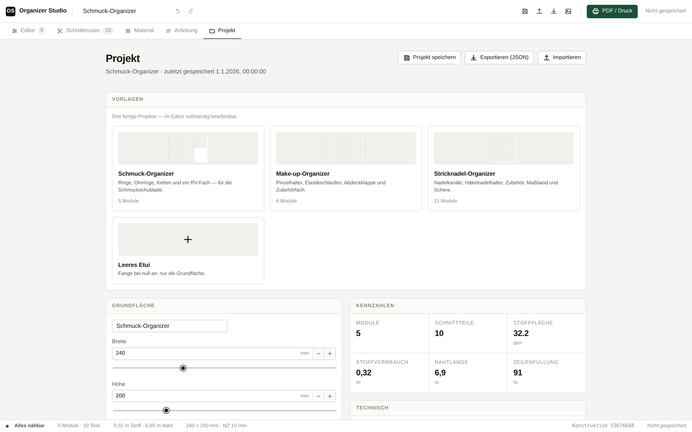
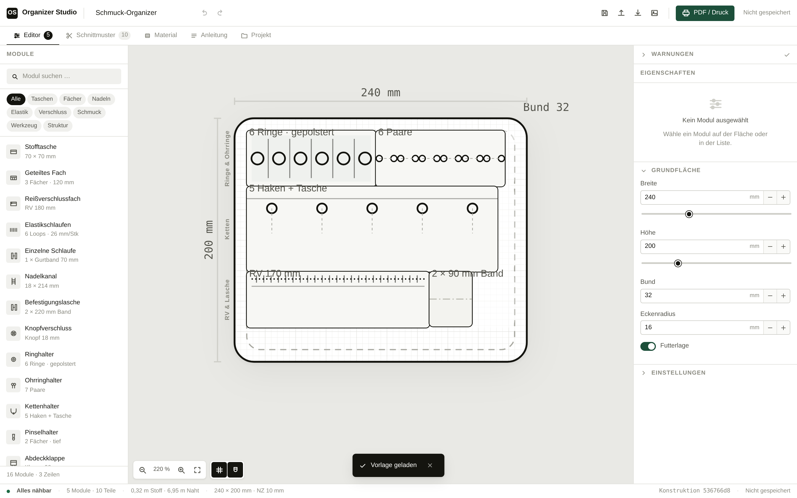
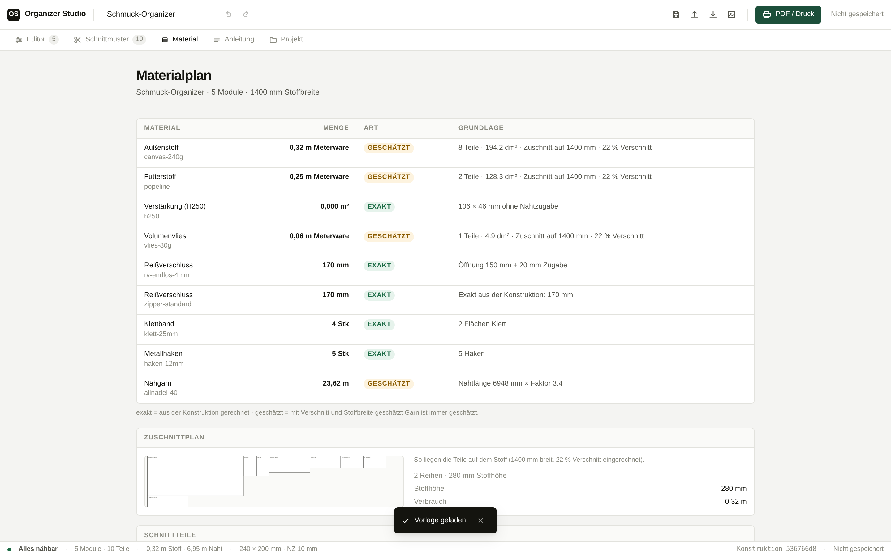
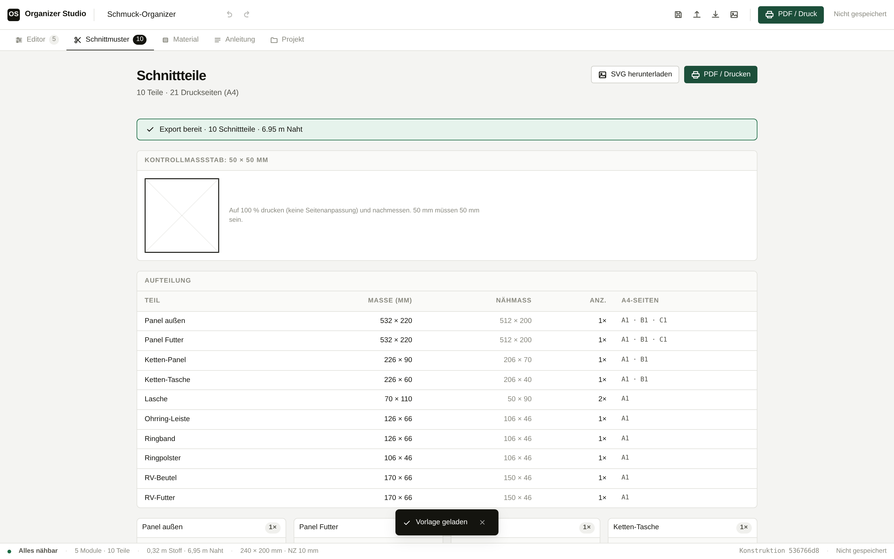
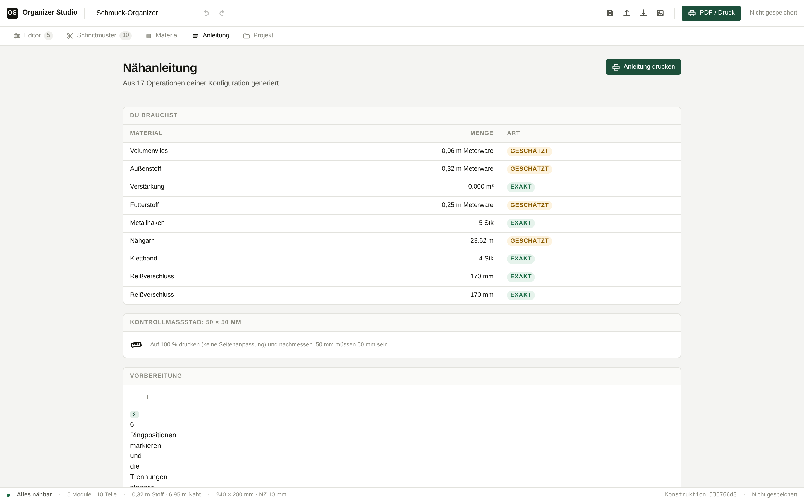
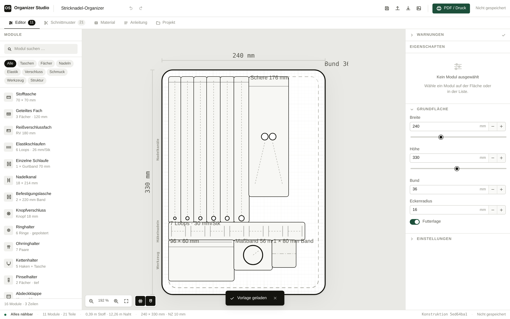

# Organizer Studio

[](https://github.com/DigitalPotentialNord/Sew/actions/workflows/ci.yml)
[](https://github.com/DigitalPotentialNord/Sew/actions/workflows/pages.yml)

**Live-Test (GitHub Pages):** <https://digitalpotentialnord.github.io/Sew/>

**Ein browserbasiertes Werkzeug, das aus einer Liste „was nimmst du mit“ ein
maßhaltiges Näh-Schnittmuster macht — mit Materialliste, Zuschnittplan und
Nähanleitung, ohne Konto, ohne CAD.**

Ein Etui für Stricknadeln, Schmuck oder Make-up entsteht nicht am Bildschirm,
sondern an der Nähmaschine. Wer es selbst näht, braucht drei Dinge: ein
Schnittmuster, das in Millimetern stimmt, eine Materialliste, die zum Einkaufen
reicht, und eine Reihenfolge, in der man nähen kann. Genau diese drei Dinge
erzeugt dieses Programm aus einer Beschreibung wie „6 Nadelkanäle à 4–8 mm,
eine Häkelreihe, ein Scherenfach“.

```
Project (Absicht)              construct()                Construction (Ausgabe)
─────────────────              ───────────                ──────────────────────
Grundfläche, Bund      ───►    layout()        ───►   Module platziert + Findings
Zeilen (Reihen)                buildPieces()   ───►   Schnittteile mit Nahtzugabe
Module + Parameter             buildMaterials()──►   Mengen + Zuschnittplan
Nahtzugabe, Stoffbreite        buildOperations()──►   Nähschritte, sortiert
                               projectHash     ───►   8 Hex-Zeichen (Golden-Werte)
                                          │
                                          ▼
                       SVG · A4-Kacheln (PDF) · Druck-HTML · JSON
```

Das Projekt ist bewusst **eine Absicht, kein Ergebnis**: gespeichert werden nur
Grundfläche, Zeilen, Module und Parameter. Alle Maße, Teile, Mengen und
Nähschritte werden bei jeder Änderung neu berechnet. Ein Projekt, das man
öffnet, ist deshalb immer konsistent — es gibt keinen Zustand, in dem Liste und
Schnittmuster auseinanderlaufen können.

---

## 1. In 60 Sekunden lauffähig

```bash
cd app
npm install
npm run dev          # → http://localhost:5173
```

Kein Backend, kein Konto, keine Datenbank. Der Editor läuft vollständig im
Browser; Projekte liegen im `localStorage`, Exporte sind Dateien.

| Befehl | Zweck |
| --- | --- |
| `npm run dev` | Dev-Server auf `0.0.0.0:5173` (bewusst: Arena-Live-Preview braucht fremde Hosts; lokal nur Loopback → `npx vite --host 127.0.0.1`) |
| `npm run build` | Typen prüfen + Produktionsbuild nach `dist/` |
| `npm run typecheck` | `tsc --noEmit` |
| `npm run lint` | ESLint 9 (flat config) |
| `npm test` | 347 Unit-Tests (Vitest, `src/_tests/`) |
| `npm run e2e` | 30 Abnahmetests (Playwright, `tests/`) |
| `npm run check` | typecheck + lint + test — **vor jedem Commit** |

Voraussetzungen: Node ≥ 20, kein weiteres Tooling. Für die E2E-Tests einmalig
`npx playwright install chromium`.

**Schnellster Einstieg für Menschen:** `npm run dev`, dann Tab „Projekt“ →
Vorlage „Stricknadel-Organizer“. Drei Vorlagen sind darauf getestet, dass sie
**0 Fehler und 0 Warnungen** erzeugen; jede andere Konstellation ist ein echter
Testfall.

---

## 2. Der Aufbau in einem Bild

```
app/
├── src/
│   ├── core/            ← der Kern: reine Funktionen, kein React, keine Zeit, kein Zufall
│   │   ├── types.ts         Domänentypen (Module, Teile, Findings, Operationen)
│   │   ├── geometry.ts      mm-Typ, Rect-Mathematik, Hash, SVG-Pfade
│   │   ├── modules.ts       die 16 Module: Maße, Schnittteile, Regeln, Zeichnung (1508 Zeilen)
│   │   ├── construction.ts  Pipeline: layout → pieces → materials → operations → findings
│   │   ├── practice.ts      alle Praxiswerte (Nahtzugabe, Garnfaktor, Grenzwerte) — eine Stelle
│   │   ├── fixes.ts         „Problem beheben“-Aktionen
│   │   ├── export.ts        SVG, A4-Kachelung, Druck-HTML
│   │   ├── pdf.ts           echtes PDF mit pdf-lib (vektoriell, maßhaltig)
│   │   └── project.ts       Zod-Schema, Migration, localStorage, Vorlagen
│   ├── state/store.ts   ← Zustand: Projekt (undo-fähig) getrennt von Session (flüchtig)
│   ├── ui/              ← React: 5 Ansichten + Canvas + Panels
│   └── i18n/de.ts       ← alle sichtbaren Texte (Deutsch), 535 Schlüssel
├── tests/acceptance.spec.ts   ← die Abnahmekriterien aus `docs/product/prd.md`, als Playwright-Test
└── docs-shots/                ← Screenshots des laufenden Editors + Beispiel-PDF
```

**Die eine Regel, die den ganzen Aufbau erklärt:** `src/core/` kennt weder React
noch `localStorage` noch `Date.now()`. Der Kern ist eine Funktion
`Project → Construction`. Deshalb ist er in Node testbar (347 Tests laufen in
~2 s), deterministisch und für ein zweites Frontend wiederverwendbar.

---

## 3. Die App in Bildern

| Vorlagen | Editor (Schmuck) |
| --- | --- |
|  |  |
| **Material** | **Schnittmuster** |
|  |  |
| **Anleitung** | **Dichte Vorlage (Strick, 11 Module)** |
|  |  |

Alle Bilder sind Screenshots des laufenden Editors, nicht Mockups.
Weitere (Tablet, Telefon, gedrehtes Modul) liegen in `app/docs-shots/`,
ein Beispiel-PDF in `app/docs-shots/schnittmuster-beispiel.pdf`.

---

## 4. Was die App kann

### Drei Vorlagen, alle geprüft

| Vorlage | Grundfläche | Module | Teile | Prüfung | Hash |
| --- | --- | --- | --- | --- | --- |
| Schmuck-Organizer | 240 × 200 mm, Bund 32 | 5 | 10 Zuschnittteile | 0 Fehler / 0 Warnungen | `e4396906` |
| Make-up-Organizer | 280 × 240 mm, Bund 30 | 6 | 13 Zuschnittteile | 0 / 0 | `deb5f0a6` |
| Stricknadel-Organizer | 240 × 330 mm, Bund 36 | 11 | 21 Zuschnittteile | 0 / 0 | `a3bda729` |

Die Hashes sind Golden-Werte: sie ändern sich, wenn sich Geometrie, Praxiswerte
oder Parameterauswertung ändern. Tests halten Determinismus und
Vorlagen-Prüfergebnisse fest; die literalen Hashes stehen hier und in
`AGENTS.md` als Referenz und in `docs/PHASE-3.md`.

### Fünf Ansichten

1. **Editor** — Canvas mit Grundfläche, Zeilen, Modulen; Bibliothek links,
   Eigenschaften und Warnungen rechts; Zoom 0,35–14, Raster, Snapping, Undo/Redo.
2. **Schnittmuster** — Kontrollmaßstab 50 × 50 mm, Aufteilung je Teil auf
   A4-Seiten, Maßtabelle.
3. **Material** — Mengen mit Einheit und Grundlage („170 mm · Öffnung 150 mm +
   20 mm Zugabe“), Zuschnittplan auf der Stoffbahn, exakt vs. geschätzt.
4. **Anleitung** — topologisch sortierte Nähschritte in fünf Phasen.
5. **Projekt** — Vorlagen, Speichern, Laden, JSON-Import/-Export.

### Ausgabe

- **PDF** (vektoriell, 1 mm = 72/25,4 pt): Deckblatt mit Kontrollmaßstab,
  Material, Zuschnitt, eine Seite je Kachel mit Klebekanten, Anleitung.
- **Druck-HTML** aus demselben Kern, für den Browser-Druckdialog.
- **SVG** des ganzen Schnittmusters.
- **JSON** des Projekts (schema-versioniert, migrierbar).

---

## 5. Wie man es bedient

| Aktion | Maus | Tastatur |
| --- | --- | --- |
| Modul hinzufügen | Bibliothek-Kachel klicken oder auf Canvas ziehen | — |
| Auswählen | Klick auf Modul | `Tab` + `Enter`/`Space` |
| Verschieben | ziehen | — |
| Drehen (90°) | Knopf „Drehen“ in der Werkzeugleiste | `R` (genau ein Modul gewählt) |
| Duplizieren | — | `Ctrl/⌘ + D` |
| Löschen | — | `Entf` / `Rücktaste` |
| Undo / Redo | Knöpfe oben | `Ctrl/⌘ + Z` / `Ctrl/⌘ + Shift + Z` |
| Auswahl aufheben | Klick ins Leere | `Esc` |
| Ansicht wechseln | Tabs | `1`…`5` |

---

## 6. Wo die Wahrheit liegt

Dieses Repository hat zwei Ebenen Dokumentation. Verwechslung ist der häufigste
Einstiegsfehler:

| Ebene | Pfad | Status |
| --- | --- | --- |
| **Spezifikation & Recherche** | `docs/` | Phase 1–2, abgeschlossen. Beschreibt Absicht, Markt, Architektur, Teststrategie. Enthält auch **nicht Gebautes** (Rollenform, Expertenmodus). |
| **Implementierung** | `app/src/`, `app/tests/` | Phase 3, lauffähig. Der Code ist hier die Wahrheit. |

Wo beide voneinander abweichen, gilt der Code — und die Abweichung steht in
[`docs/PHASE-3.md`](docs/PHASE-3.md) §3, u. a. eine Tabelle, in der die
Modul-IDs der Spezifikation anderen Modulen entsprechen als in der
Implementierung. **IDs wurden absichtlich nicht umbenannt** (Bestanddaten,
Tests und Hashes hängen daran).

---

## 7. Dokumentenkarte

### Einstieg
- **[AGENTS.md](AGENTS.md)** — Anleitung für KI-Assistenten: Regeln, Fallen,
  Prüfbefehle, Landkarte. *Wer hier mit einem Agenten arbeitet, liest das zuerst.*
- **[docs/PHASE-3.md](docs/PHASE-3.md)** — was gebaut ist, was nicht, und warum.
- **[docs/engineering/README.md](docs/engineering/README.md)** — Übersicht der
  technischen Dokumente inkl. Abweichungen Code ↔ Spezifikation.

### Spezifikation (`docs/`)
- `product/prd.md` — Anforderungen, Regeln (V-G/V-M), Abnahmekriterien.
- `product/module-library.md` — die 16 Module fachlich (Spezifikations-IDs!).
- `product/user-flows.md`, `product/mvp-scope.md`, `product/product-vision.md`.
- `engineering/` — Architektur, Geometrie-Engine, Konstruktionsregeln,
  Materialberechnung, Export-System, Datenmodell, Teststrategie.
- `research/` — Markt, Wettbewerber, Zielgruppen, `decision-brief.md`.
- `architecture-review.md` — 15 Architekturentscheidungen (K-01…M-15), die die
  Implementierung binden.

---

## 8. Was dieses Projekt nicht ist

- **Kein CAD.** Keine freie Kontur, keine Booleschen Operationen. Ein Etui in
  Buchform, zwei Lagen Stoff, ein Bund, Zeilen mit Modulen.
- **Keine Cloud.** Kein Konto, kein Server, kein Tracking. Projekte im Browser.
- **Kein fertiges Produkt.** Phase 3 ist ein lauffähiger Prototyp mit
  dokumentierten Lücken (siehe `docs/PHASE-3.md` §4) — nicht marktreif.
- **Kein deutsch-englisches Projekt.** Die Oberfläche ist deutsch; Code,
  Kommentare und Bezeichner sind deutsch, weil die Fachbegriffe (Nahtzugabe,
  Fadenlauf, Einschlag) deutsch sind. Englisch wäre hier eine Übersetzung
  zusätzlich zur Sache.

---

## 9. Stand

26. November 2026 · Praxiswerte v1.2.0 · Schema v2

| Prüfung | Ergebnis |
| --- | --- |
| `npx tsc --noEmit` | 0 Fehler (strict, `noUncheckedIndexedAccess`) |
| `npx eslint src` | 0 Fehler (u. a. `no-explicit-any` verboten) |
| `npx vitest run` | **228 Tests** in 8 Dateien |
| `npx playwright test` | **30 Tests** (Abnahmekriterien aus `docs/product/prd.md`) |
| `npm run build` | OK · Editor 388 kB (gzip 111 kB) · PDF separat 428 kB |

Die Zahlen sind nachprüfbar; sie stehen als Prüfblock auch in `AGENTS.md` und
sollten dort aktualisiert werden, wenn sie sich ändern.
